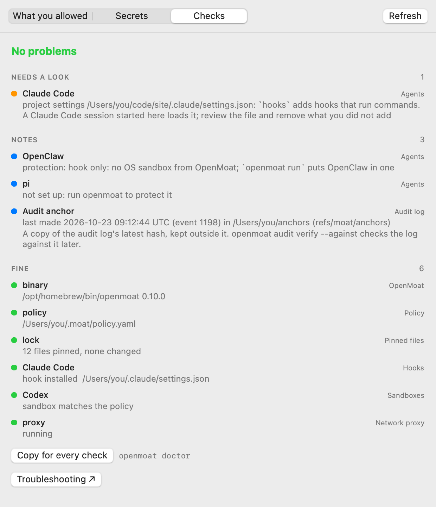

<p align="center">
  
</p>

<h1 align="center">OpenMoat Bar</h1>

<p align="center">
  See what <a href="https://github.com/crocodile-labs/openmoat">OpenMoat</a> does for your coding agents, from the menu bar.
</p>

<p align="center">
  <a href="https://github.com/crocodile-labs/openmoat-bar/releases"></a>
  
  <a href="desktop"></a>
  <a href="desktop"></a>
  <a href="#license"></a>
  <a href="https://openmoat.dev"></a>
</p>

OpenMoat Bar shows which of your coding agents are protected, what OpenMoat blocked today and why,
and tells you when protection drops. It is read-only: it never allows anything or changes a rule;
every fix is a command you copy into your terminal.

## Why

- **See protection at a glance.** One croc in the menu bar: plain when every agent is protected,
  red the moment one isn't.
- **Understand every block.** What ran, which rule stopped it and why, with the command to check
  it yourself.
- **Catch what needs you.** Changed MCP servers, a policy update, a pinned file that changed, a
  project settings file that could switch OpenMoat off.
- **Nothing changes behind your back.** It only reads OpenMoat's output.

## Supported agents

Every agent OpenMoat protects, each with its own tab:

| | Agent | Protection by OpenMoat |
| --- | --- | --- |
| <picture><source media="(prefers-color-scheme: dark)" srcset="docs/images/agents/claude-dark.png"></picture> | Claude Code | Hook + OS sandbox |
| <picture><source media="(prefers-color-scheme: dark)" srcset="docs/images/agents/codex-dark.png"></picture> | Codex | Hook + OS sandbox |
| <picture><source media="(prefers-color-scheme: dark)" srcset="docs/images/agents/cursor-dark.png"></picture> | Cursor | Hook + OS sandbox |
| <picture><source media="(prefers-color-scheme: dark)" srcset="docs/images/agents/openclaw-dark.png"></picture> | OpenClaw | Hook |
| <picture><source media="(prefers-color-scheme: dark)" srcset="docs/images/agents/copilot-dark.png"></picture> | GitHub Copilot CLI | Hook |
| <picture><source media="(prefers-color-scheme: dark)" srcset="docs/images/agents/pi-dark.png"></picture> | pi | Hook |
| <picture><source media="(prefers-color-scheme: dark)" srcset="docs/images/agents/gemini-dark.png"></picture> | Gemini CLI | Hook |

Calls from the Continue CLI, which runs Claude Code's hook, are named too. Each agent's tab shows
the level `openmoat status` reports on your machine (on Windows, OpenMoat has no OS sandbox).

| Platform | App |
| --- | --- |
| macOS 12 or later | Menu bar app, Details and Activity windows, Settings |
| Linux, Windows | Tray app with the same features ([`desktop/`](desktop), [compared with macOS](desktop/MAC_COMPARISON.md)); built, tested and drawn in CI on Ubuntu and Windows |


## What it shows

**The menu**
- A tab per agent, with its icon and its protection level.
- Today's calls per hour, with blocks in red.
- Blocked, Asked, Left to your agent and Allowed, with counts. Hover one for its calls, and a
  call for the whole story: what ran, the rule, what the agent was told and why, with an
  `openmoat policy check` command to copy.
- Security checks for each agent, the network proxy and OpenMoat itself. When an agent's own
  settings turn OpenMoat's hook off, the check names that file.

<p align="center">
  
</p>

**The croc in the menu bar** changes with what needs you:

| Icon | Meaning |
| --- | --- |
| Plain | All protected, nothing new |
| Dot | New blocks since you last looked |
| Amber | A security check needs a look |
| Red | An agent stopped being protected |
| Faded | OpenMoat isn't installed or can't be read |

**Notices**
- **Policy update available:** a newer default policy has changes; copy `openmoat policy upgrade`.
- **OpenMoat's files changed:** a pinned file was changed or removed; copy `openmoat doctor`.
- **MCP server changes wait for you:** a server's definition or tools changed since you accepted
  them, so OpenMoat holds its tool calls; copy `openmoat mcp accept <server>`.
- **Project settings need a look:** a project settings file could switch OpenMoat off or run a
  program, such as a `.claude/settings.json` with `hooks` or `env`; each file is listed with what
  it sets.

**Rules explained.** Every decision says in one line why its rule exists, for every rule in
OpenMoat's default policy, the rules OpenMoat adds itself, a policy's defaults, policy packs and a
repository's own policy. A call the agent's hook showed only in part says what OpenMoat could not
see.

**The Details window**
- **What you allowed:** permanent rules, session grants with their project and end time, and
  trusted repositories, each with the command that takes it back.
- **Secrets:** each brokered secret's id, host and source, whether the agent can still read the
  source, and the port for a plain-HTTP secret. Never a value.
- **Checks:** every `openmoat doctor` check, grouped and explained.



**The Activity window** (⌘A): today, 7 days or 30 days; filter by agent, verdict and rule; open
one call; export as JSON lines.


**Notifications**
- Always when an agent stops being protected.
- Blocked calls only if you turn them on in Settings; they name the rule and the agent, never the
  command.
- Never for calls your agent already asks you about.

<p align="center">
  
</p>

## Install

OpenMoat must be installed first ([quick start](https://openmoat.dev/docs/quickstart/)).

```bash
# macOS and Linux
curl --proto '=https' --tlsv1.2 -LsSf https://github.com/crocodile-labs/openmoat-bar/releases/latest/download/openmoat-bar-installer.sh | sh
```

```powershell
# Windows
powershell -ExecutionPolicy Bypass -c "irm https://github.com/crocodile-labs/openmoat-bar/releases/latest/download/openmoat-bar-installer.ps1 | iex"
```

The installer checks the download against the release's `SHA256SUMS` and installs for your user:

| System | Where | Remove it |
| --- | --- | --- |
| macOS (Apple silicon and Intel) | `~/Applications/OpenMoat Bar.app` | `rm -rf ~/Applications/OpenMoat\ Bar.app` |
| Linux x86_64 | `~/.local/share/openmoat-bar`, `openmoat-bar` in `~/.local/bin`, an app menu entry | `rm -rf ~/.local/share/openmoat-bar ~/.local/bin/openmoat-bar ~/.local/share/applications/dev.openmoat.bar.desktop` |
| Windows x64 | `%LOCALAPPDATA%\Programs\OpenMoat Bar` and a Start menu entry | Delete that folder and the Start menu entry |

## Build from source

OpenMoat must be installed to run it.

### macOS

```bash
git clone https://github.com/crocodile-labs/openmoat-bar
cd openmoat-bar
make app            # Swift 5.7 or later (Xcode or the Command Line Tools)
open "OpenMoat Bar.app"
```

`make app` builds with `swiftc` directly where `swift build` cannot read `Package.swift`.

### Linux

```bash
# Build tools and Qt 6.4 or later with Qt Quick
# Ubuntu 24.04+, Debian 12+:
sudo apt install build-essential cmake git qt6-base-dev qt6-declarative-dev \
  qml6-module-qtquick qml6-module-qtquick-controls qml6-module-qtquick-layouts \
  qml6-module-qtquick-templates qml6-module-qtquick-window qml6-module-qtqml-workerscript
# Fedora:
sudo dnf install gcc-c++ cmake git qt6-qtbase-devel qt6-qtdeclarative-devel
# Arch:
sudo pacman -S --needed base-devel cmake git qt6-base qt6-declarative

git clone https://github.com/crocodile-labs/openmoat-bar
cd openmoat-bar
cmake -S desktop -B build -DCMAKE_BUILD_TYPE=Release
cmake --build build --parallel
./build/src/app/openmoat-bar
```

CI runs the Ubuntu line as written. On GNOME without tray support (Fedora, for example), install
the "AppIndicator and KStatusNotifierItem Support" extension; without it OpenMoat Bar opens as a
window from the app menu.

### Windows

```powershell
# Build tools
winget install --id Git.Git
winget install --id Kitware.CMake
winget install --id Python.Python.3.12
winget install --id Microsoft.VisualStudio.2022.BuildTools --override "--add Microsoft.VisualStudio.Workload.VCTools --includeRecommended --passive --wait"
```

In a new PowerShell window:

```powershell
# Qt 6.7.3, without a Qt account
python -m pip install aqtinstall
python -m aqt install-qt windows desktop 6.7.3 win64_msvc2019_64 --outputdir C:\Qt

git clone https://github.com/crocodile-labs/openmoat-bar
cd openmoat-bar
cmake -S desktop -B build -DCMAKE_PREFIX_PATH=C:\Qt\6.7.3\msvc2019_64
cmake --build build --config Release
cmake --install build --config Release --prefix openmoat-bar
C:\Qt\6.7.3\msvc2019_64\bin\windeployqt.exe openmoat-bar\bin\openmoat-bar.exe
.\openmoat-bar\bin\openmoat-bar.exe
```

Every CI run also draws the Linux and Windows windows offscreen; download
`moatbar-linux-screenshots` or `moatbar-windows-screenshots` from the run. More in
[desktop/README.md](desktop/README.md).

## How it works

OpenMoat Bar runs only these read-only commands, each with `--format json`:

- `openmoat status`, `openmoat show`, `openmoat report`, `openmoat proxy status`, `openmoat --version`
- `openmoat allowed`, `openmoat secret list` and `openmoat doctor`, for the Details window

It matches whole command lines, so `openmoat doctor --accept` or `openmoat secret add` can never
run. It re-reads when OpenMoat's audit log changes (within 2 seconds), every minute and when you
open the menu, and writes nothing to `~/.moat`. See [docs/ARCHITECTURE.md](docs/ARCHITECTURE.md).

## Develop

```bash
make build   make test   make lint   make format
./Scripts/snapshots.sh   # re-render the screenshots from the app's views
```

Read [AGENTS.md](AGENTS.md) and [CONTRIBUTING.md](CONTRIBUTING.md) first. Changes are listed in
[CHANGELOG.md](CHANGELOG.md); everyone taking part follows the [Code of Conduct](CODE_OF_CONDUCT.md).

## Privacy

OpenMoat Bar makes no network requests and sends nothing anywhere. It reads only what the
`openmoat` commands above print, on your machine; links to the docs open in your browser when you
click them.

## Security

A way to make OpenMoat Bar write state, approve a call, run a command or show a secret is a
vulnerability: report it privately as [SECURITY.md](SECURITY.md) describes, not in a public issue.

## Credits

Inspired by [CodexBar](https://github.com/steipete/CodexBar).

## License

[MIT](LICENSE) or [Apache-2.0](LICENSE-APACHE), at your option.
